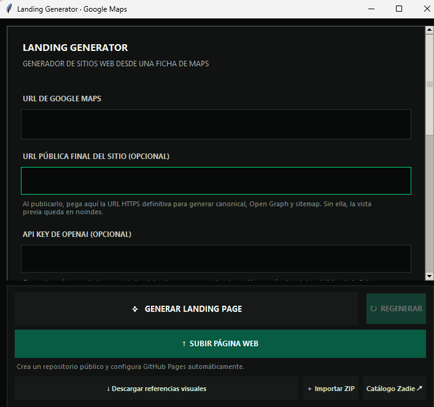

# AI Landing Page Generator para Google Maps

Aplicación de escritorio para crear landing pages comerciales a partir de una ficha pública de Google Maps. Combina extracción con Playwright, validación de datos, dirección artística asistida por IA y un renderer propio para generar sitios estáticos, responsive y editables.

<p align="center">
  
</p>

## Funcionalidades

- Importa información visible de una ficha de Google Maps y fotos disponibles.
- Genera contenido y dirección visual mediante OpenAI Structured Outputs; también funciona sin API key.
- Produce páginas HTML independientes con diseño responsive, animaciones, galería y llamadas a la acción.
- Selecciona hasta dos tratamientos visuales según rubro, dirección artística y cantidad de fotos: vidrio sutil, órbitas ambientales, revelado editorial o galería cinética.
- Incluye únicamente reseñas verificadas con una puntuación superior a 4 estrellas.
- Crea metadatos SEO, datos estructurados, sitemap y robots cuando se proporciona la URL pública.
- Permite regenerar variantes y conserva cada borrador en una carpeta separada.
- Publica el sitio en un repositorio público y configura GitHub Pages desde la GUI.
- Incluye en el ZIP del proyecto las colecciones de referencias HTML que utiliza el generador, con sus licencias y archivos de atribución.

La API de OpenAI solo se usa durante la generación. El sitio resultante es HTML, CSS y JavaScript autónomo.

Los efectos son una capa selectiva sobre las familias visuales existentes, no plantillas importadas. El modelo devuelve `visual_effects` dentro del JSON validado; si no hay API, se aplican reglas locales conservadoras. Los efectos pueden quedar vacíos. Las galerías animadas solo se activan con suficiente material fotográfico y se degradan a desplazamiento táctil en móvil.

> Los sitios son borradores para revisión. No se publican automáticamente ni garantizan posicionamiento. Verifica cada dato y consigue autorización para reutilizar fotografías, reseñas y demás materiales antes de entregar un sitio.

## Instalar en Windows

1. Instala Python 3.10 o posterior y Google Chrome.
2. Abre PowerShell dentro de esta carpeta.
3. Instala dependencias y Chromium para Playwright:

   ```powershell
   python -m pip install -r requirements.txt
   python -m playwright install chromium
   ```

4. Opcionalmente, copia `.env.example` a `.env` y configura `OPENAI_API_KEY` y `OPENAI_MODEL`. El archivo `.env` está excluido de Git. También puedes pegar la clave en la GUI; no se guarda en los resultados.
5. Inicia la aplicación:

   ```powershell
   python app.py
   ```

## Uso

1. Pega una URL pública de Google Maps.
2. Elige una familia de negocio o deja la detección automática.
3. Elige una dirección artística o deja que la IA la defina.
4. Selecciona un modelo y, si quieres, agrega notas con datos confirmados del negocio.
5. Pulsa **Generar landing page**. El extractor abre la ficha pública en Chrome instalado como visitante, cierra los avisos opcionales de acceso y recoge la información que puede verificar en pantalla.
6. Se crea una carpeta nueva en `salida/`; la GUI abre el HTML y muestra el estado del control de calidad.
7. Pulsa **Regenerar** para producir otra combinación sin borrar los borradores anteriores.
8. Pulsa **Subir página web**, selecciona una carpeta de `salida/` que contenga `index.html` en la raíz y espera a que termine la publicación.

La GUI incluye un **Registro de actividad** con las etapas de extracción, generación, control de calidad y publicación. **Descargar referencias visuales** verifica y descarga las referencias UIUXLabz de todas las categorías, sin necesitar una ficha ni una categoría seleccionada; las demás colecciones ya vienen en la descarga del proyecto. Si aparece un error, copia el registro con **Copiar log** y compártelo para diagnosticarlo. El archivo completo también se guarda localmente en `usage/app.log`; puede incluir nombres de negocios y rutas locales, pero no registra la clave de OpenAI.

Las colecciones de plantillas de referencia se incluyen dentro de `plantillas/fuentes/` para que una descarga nueva del repositorio tenga los recursos locales disponibles. Sus licencias y atribuciones originales se conservan junto a cada colección o plantilla; consulta [el inventario de fuentes](docs/template-library.md) antes de reutilizar esos archivos fuera del generador.

## Publicar con GitHub Pages

Instala [Git for Windows](https://git-scm.com/download/win) y [GitHub CLI](https://cli.github.com/). Si todavía no autorizaste tu cuenta, al pulsar **Subir página web** el programa abrirá una consola visible y el navegador para completar el inicio de sesión de GitHub. Al terminar, la misma subida continúa automáticamente. GitHub CLI guarda la sesión en el almacén de credenciales del sistema; el generador no guarda ni solicita un token.

Después, **Subir página web** crea un repositorio público con el nombre del negocio, sube los archivos del sitio a `main`, fija `main` como rama predeterminada y configura GitHub Pages para publicar desde `/` (raíz). Si ese nombre ya está ocupado, crea el siguiente nombre disponible con sufijo (`-2`, `-3`, etc.) y nunca sobrescribe otro repositorio. Muestra el enlace del repositorio y el sitio cuando termina.

El sitio y el repositorio son públicos. Para proteger los archivos internos del generador, no se suben `business_data.json`, `design_spec.json`, `quality_report.json`, `image_manifest.json`, capturas, carpetas `.git` ni archivos de secretos `.env`/llaves. Se publica el `index.html`, los recursos del sitio y se añade `.nojekyll`, `robots.txt`, `sitemap.xml`, canonical y Open Graph con la URL pública.

GitHub Pages puede tardar unos minutos en mostrar el sitio después de configurar la rama. Si el publicador no encuentra `gh` o Git, indica cómo instalarlos.

La extracción no intenta resolver CAPTCHA, iniciar sesión ni eludir restricciones. La ficha puede cambiar según el idioma, el estado de carga o la estructura de Maps; los datos faltantes quedan vacíos y se indican en los archivos de salida. En “Lo que comparten nuestros clientes” solo se muestran reseñas auténticas con una puntuación estrictamente superior a 4 estrellas, tras limpiar metadatos e íconos de Google Maps y validar el texto y el origen. Si una tarjeta contiene solo metadatos de Maps y no un comentario real, se descarta. La calificación general del negocio se conserva como dato separado.

Si Google Maps redirige la ficha mientras Playwright lee el contenido, el extractor espera a que la página se estabilice y reintenta la lectura hasta tres veces; cada reintento aparece en el Registro de actividad de la GUI.

## Qué decide la IA

La IA actúa como directora creativa. Produce una especificación JSON validada, no HTML libre. Decide la familia de estilo, composición, secciones y redacción. El renderer propio controla las secciones, inserta únicamente datos disponibles, escapa contenido y construye los enlaces de contacto.

Direcciones artísticas disponibles:

- Editorial premium
- Luxury
- Minimal moderno
- Corporativo premium
- Bold creativo
- Orgánico natural
- Elegante oscuro
- Negocio local contemporáneo

La composición también varía entre división texto/foto, editorial, centrada e inmersiva. La IA elige además un tratamiento de fotografía: recorte editorial, mosaico, tira cinematográfica o grilla minimalista; el renderer ajusta las proporciones al número de imágenes. Si no hay foto utilizable, se crea una ilustración geométrica deliberada; no se presenta como una foto del local. Las imágenes de Maps se descargan localmente, se convierten a WebP y quedan enumeradas con su origen en `image_manifest.json`.

### SEO técnico para publicar

En **URL pública final del sitio**, pega la URL HTTPS donde quedará publicada esa landing. Con ese dato, el HTML incorpora URL canónica, metadatos Open Graph/Twitter, título y descripción específicos del negocio/rubro/localidad, `LocalBusiness` JSON-LD con los datos verificados, y se generan `robots.txt` y `sitemap.xml`. La vista previa sin URL pública lleva `noindex,nofollow` para evitar que una copia de trabajo se indexe accidentalmente. Sube `index.html`, `assets/`, `robots.txt` y `sitemap.xml` a la raíz de esa dirección.

Después de publicar: verifica el dominio en Google Search Console, inspecciona la URL y envía el sitemap; confirma que el servidor responde por HTTPS, que no bloquea Googlebot y que la URL canónica coincide con la dirección publicada. Completa y verifica también el Perfil de Negocio de Google del propietario. El HTML mejora la capacidad de rastreo y comprensión, pero el posicionamiento depende también de la competencia, la relevancia local, la utilidad del contenido, la reputación y la autoridad del sitio; no se promete una posición específica. No se añade marcado de estrellas para reseñas de Google copiadas: el marcado de reseñas propias para el mismo negocio no es una forma válida de conseguir estrellas enriquecidas.

### Motion design

Las páginas exportadas incluyen GSAP 3.15.1 con ScrollTrigger, Flip y Observer embebidos, así que estas interacciones funcionan desde el HTML local sin depender de un CDN. La entrada del hero cambia según la dirección artística: títulos por líneas en estilos editoriales y luxury, movimientos de palabras más activos en bold y minimal, y máscaras y ritmos propios para las demás familias. También hay revelados por scroll, progreso de lectura y microinteracciones.

Las fotos del negocio se pueden abrir en una vista inmersiva, navegar con flechas o teclado y cerrar para animarlas de vuelta a su posición original. Cuando hay suficientes fotos se activa un recorrido horizontal fijado en escritorio; en móvil queda como carrusel deslizable nativo. Tres o más reseñas verificadas se presentan en un carrusel táctil con controles, y los servicios confirmados se pueden expandir. Los diseños combinan tipografía y motivos SVG por dirección artística, con composiciones asimétricas cuando el contenido permite darles espacio.

La IA selecciona uno o dos efectos por generación usando el rubro, la dirección artística, las fotos, una semilla de variante y las firmas visuales de hasta seis borradores anteriores del negocio. Así puede variar efectos, composición o dirección artística sin perder coherencia. `glass_surfaces` agrega paneles translúcidos; `ambient_orbits` crea formas orbitales alrededor del hero; `editorial_reveal` revela títulos y fotografía; `kinetic_gallery` habilita un recorrido de galería solo si hay al menos cuatro imágenes; `photo_depth` añade respuesta 3D al puntero y una transición Flip al ampliar una foto. El renderer aplica exactamente los efectos elegidos por el modelo. Sin API se usa una selección local compatible. La IA evita vidrio en rubros donde una estética sobria ayuda a la confianza. El movimiento respeta `prefers-reduced-motion` y se mantiene sin dependencias externas de runtime.

Las referencias visuales revisadas están en [docs/visual-effect-references.md](docs/visual-effect-references.md). Se implementaron tratamientos originales inspirados en patrones generales de diseño; no se descargó ni se copió en bloque el código, los assets o las plantillas de los autores de CodePen. Las búsquedas públicas son catálogos dinámicos y no un conjunto cerrado de temas.

El movimiento se desactiva cuando el sistema operativo solicita `prefers-reduced-motion`. Se conserva el scroll nativo; el sitio no bloquea ni reemplaza la navegación del navegador. Las cabeceras de licencia de GSAP quedan incluidas en el HTML exportado y la referencia de licencia está en `core/vendor/gsap/NOTICE.md`.


Los servicios solo se incluyen si aparecen literalmente en las notas confirmadas del usuario. No se crean premios, resultados, horarios, credenciales ni opiniones inventadas. Las reseñas defectuosas como «Foto de…», «Me gusta» o «Compartir» se descartan. Si no hay opiniones válidas, se muestra la puntuación comprobada y el enlace a la ficha, cuando estén disponibles.

## OpenAI

El SDK oficial de Python usa la Responses API y Structured Outputs con un esquema JSON estricto. `OPENAI_API_KEY`, `OPENAI_MODEL` y `OPENAI_MAX_OUTPUT_TOKENS` se pueden configurar en `.env`; la clave también puede introducirse temporalmente desde la GUI. Si la clave queda vacía, se usa la dirección artística local. Si la llamada falla, se conserva la generación local y se registra el error sin guardar la clave.

El valor inicial sigue `gpt-4.1`, que aparece como **deprecated** en la documentación oficial consultada; se puede elegir `gpt-4.1-mini` o configurar otro modelo compatible desde `.env`. Los precios de referencia cargados en el estimador son USD 2/8 por millón de tokens de entrada/salida para GPT‑4.1 y USD 0,40/1,60 para GPT‑4.1 mini. Son estimaciones y pueden cambiar; revisa la tarifa vigente antes de usar la API. Cada respuesta registra modelo y tokens en `usage/openai-usage.jsonl`. Las especificaciones se guardan localmente en caché por negocio, modelo, familia y variante para evitar pagar de nuevo por una entrada idéntica.

Documentación oficial: [Structured Outputs](https://developers.openai.com/api/docs/guides/structured-outputs?api-mode=responses), [GPT‑4.1](https://developers.openai.com/api/docs/models/gpt-4.1), [precios de la API](https://developers.openai.com/api/docs/pricing).

## Datos y calidad

Cada carpeta generada incluye:

```text
salida/nombre-del-negocio/
├── index.html
├── assets/                 # Imágenes optimizadas, si están disponibles
├── screenshots/
│   ├── desktop.png
│   └── mobile.png
├── business_data.json      # Datos, procedencia, validaciones y advertencias
├── design_spec.json        # Dirección creativa JSON
├── image_manifest.json     # Origen y estado de cada imagen
├── quality_report.json     # Errores, avisos, enlaces e informes responsive
└── GENERATED-BY.txt
```

El control de calidad abre el HTML con Playwright y revisa H1, enlaces vacíos, imágenes rotas, errores JavaScript, consistencia del enlace de WhatsApp y desbordamiento horizontal a 375, 390, 768, 1024 y 1440 px. Guarda capturas de desktop y móvil. Los errores críticos dejan `status: failed`; la aplicación informa que ese borrador necesita revisión.

## Estructura del proyecto

```text
generador_landing_maps/
├── app.py
├── config.py
├── core/
│   ├── maps_extractor.py
│   ├── data_cleaner.py
│   ├── data_validator.py
│   ├── business_analyzer.py
│   ├── reviews_processor.py
│   ├── image_manager.py
│   ├── openai_engine.py
│   ├── design_director.py
│   ├── html_renderer.py
│   ├── seo_generator.py
│   ├── quality_checker.py
│   └── pipeline.py
├── schemas/landing_schema.json
├── design_system/
├── plantillas/             # Catálogos y archivos de referencia/licencia
├── tests/
└── salida/
```

La biblioteca descargada en `plantillas/` se conserva para consulta visual. No se ingiere ni copia código de esos ZIP automáticamente: el renderer genera su propia composición con las decisiones JSON de la IA, sin arrastrar contenido demo, fotografías de muestra ni secciones en inglés. Revisá las condiciones de cada origen antes de reutilizar cualquier recurso.

## Ejecutar pruebas

Las pruebas usan datos ficticios marcados `test_data: true`; no navegan a Google Maps ni hacen llamadas facturables a OpenAI:

```powershell
python -m unittest discover -s tests -v
```

Incluyen validación telefónica, reseñas basura y duplicadas, URL, schema, renderizado seguro, WhatsApp, errores de API simulados, imágenes rotas y QA en cinco tamaños de pantalla.
