# Free HTML website templates

17 hand-built, responsive website templates in plain HTML, CSS and a little vanilla JavaScript — no framework, no build step, no dependencies. MIT licensed: use them for personal and client work.

**Browse them live, change the colours and brand name, and download a customised ZIP at [zumatools.com/website-templates](https://zumatools.com/website-templates/).**

- Landing pages, business sites, portfolios, a blog, link-in-bio, wedding and event sites, error pages and responsive HTML emails
- Responsive from 320px up, accessible (semantic HTML, skip links, labelled forms, AA contrast, reduced-motion aware)
- Themed with CSS custom properties at the top of each `style.css`
- Original SVG artwork and copy — no stock photos to license, no lorem ipsum
- Works from any static host: Netlify Drop, GitHub Pages, Cloudflare Pages, Vercel, or plain shared hosting

## Use a template

1. Pick one below (or [preview them all](https://zumatools.com/website-templates/)).
2. Copy its folder from `templates/<name>/`, or download the ZIP.
3. Edit the text in the HTML files and the colours in `assets/css/style.css` (`:root` variables).
4. Upload the folder to any static host.

Forms are wired as demos (`action="#"`); each template's README explains how to connect Formspree or Netlify Forms.

## Templates

### Pulse — SaaS landing page

[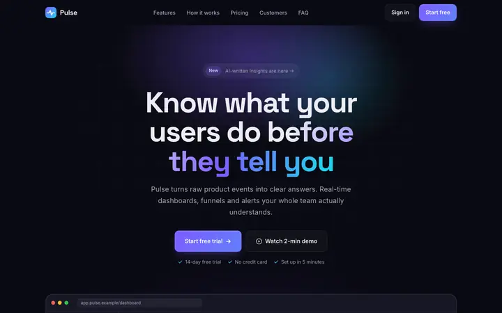](https://zumatools.com/website-templates/saas-landing/)

A dark, modern SaaS landing page with a hand-built product dashboard mock, features grid, pricing with a monthly/yearly toggle, testimonials and FAQ.

**Pages:** index.html · **Features:** Responsive, Dark design, CSS/SVG product mockup, Pricing monthly/yearly toggle, FAQ accordion, Animated stats counter

[Live preview & customise](https://zumatools.com/website-templates/saas-landing/) · [Download ZIP](https://zumatools.com/templates-zip/saas-landing.zip) · [Source](templates/saas-landing/)

### Sprout — mobile app landing page

[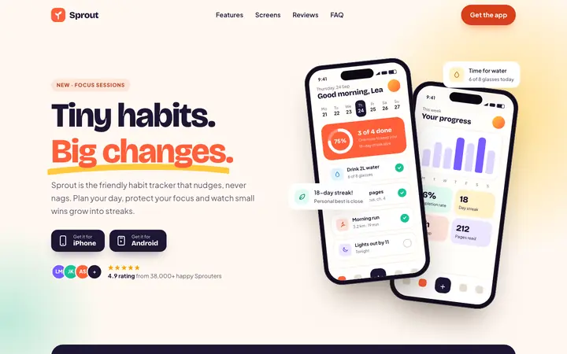](https://zumatools.com/website-templates/app-landing/)

A bright, friendly landing page for a mobile app with CSS-drawn phone mockups, feature sections, a screenshots carousel, reviews and download buttons.

**Pages:** index.html · **Features:** Responsive, Pure CSS phone mockups, Screenshots carousel (scroll-snap), Neutral iPhone/Android download buttons, Reviews, FAQ accordion

[Live preview & customise](https://zumatools.com/website-templates/app-landing/) · [Download ZIP](https://zumatools.com/templates-zip/app-landing.zip) · [Source](templates/app-landing/)

### Ember & Olive — Restaurant & café website

[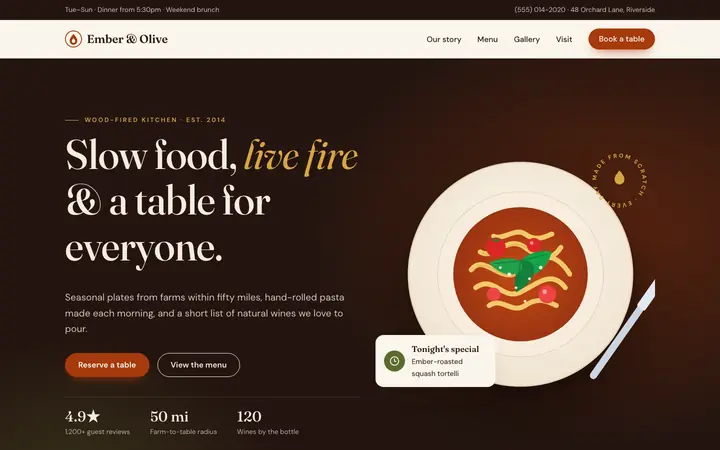](https://zumatools.com/website-templates/restaurant/)

Warm restaurant and café template with menu page, dietary filters, reservation form, opening hours, food illustrations and a map block. Free, no build step.

**Pages:** index.html, menu.html · **Features:** Responsive, Mobile menu, Full menu page with categories, Dietary tags & filters, Reservation form (date, time, party size), Opening hours with today highlight

[Live preview & customise](https://zumatools.com/website-templates/restaurant/) · [Download ZIP](https://zumatools.com/templates-zip/restaurant.zip) · [Source](templates/restaurant/)

### Haven — Real estate agency website

[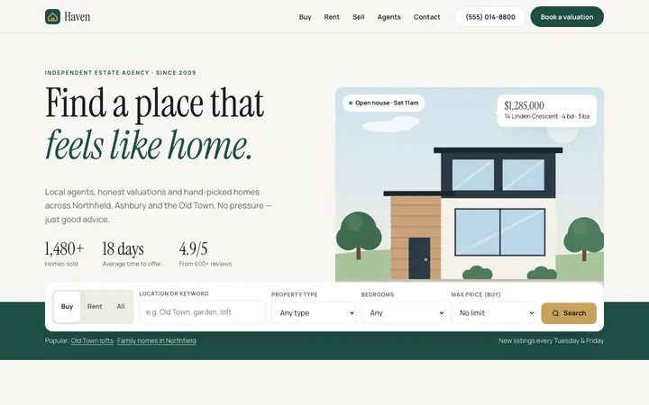](https://zumatools.com/website-templates/real-estate/)

Real estate agency template with live property search and filters, listings grid, detail page with specs, mortgage calculator, agent cards and enquiry form.

**Pages:** index.html, listing.html · **Features:** Responsive, Mobile menu, Property search & filters (vanilla JS over JSON), Sort by price / size / newest, Listings grid with price, beds, baths, area, Listing detail page driven by ?id=

[Live preview & customise](https://zumatools.com/website-templates/real-estate/) · [Download ZIP](https://zumatools.com/templates-zip/real-estate.zip) · [Source](templates/real-estate/)

### Meridian — Corporate & consulting website

[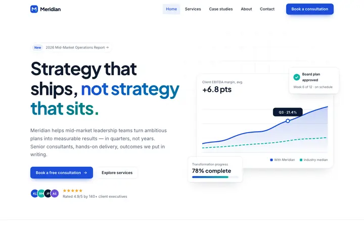](https://zumatools.com/website-templates/business/)

Crisp corporate website template for consulting and professional-services firms: services, stats, case studies, testimonials, team, pricing and contact pages.

**Pages:** index.html, services.html, about.html, contact.html · **Features:** Responsive, Mobile menu, 4 pages, Hero with data-dashboard visual, Services & engagement pricing, Animated stat counters

[Live preview & customise](https://zumatools.com/website-templates/business/) · [Download ZIP](https://zumatools.com/templates-zip/business.zip) · [Source](templates/business/)

### Volt — gym & fitness website

[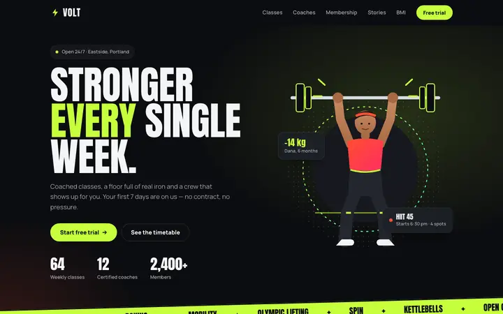](https://zumatools.com/website-templates/fitness/)

An energetic one-page gym website with a tabbed class timetable, coach profiles, membership pricing, a BMI calculator, transformation stories and a free-trial signup.

**Pages:** index.html · **Features:** Responsive, Dark design, Mobile menu, Class timetable tabs (keyboard accessible), Monthly / yearly pricing toggle, BMI calculator (metric & imperial)

[Live preview & customise](https://zumatools.com/website-templates/fitness/) · [Download ZIP](https://zumatools.com/templates-zip/fitness.zip) · [Source](templates/fitness/)

### Wildcard — creative agency website

[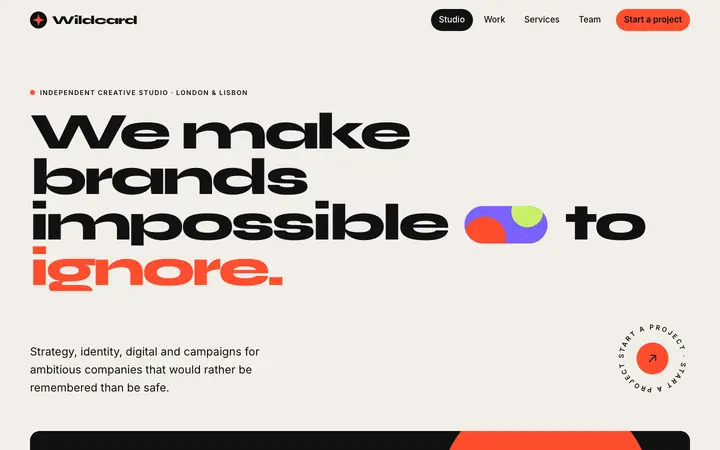](https://zumatools.com/website-templates/agency/)

A bold, big-type website for a creative agency or design studio: home, case-studies page with filters and a contact page with a project enquiry form.

**Pages:** index.html, work.html, contact.html · **Features:** Responsive, 3 pages, Big typography, Scrolling marquee, Services accordion, Filterable case studies

[Live preview & customise](https://zumatools.com/website-templates/agency/) · [Download ZIP](https://zumatools.com/templates-zip/agency.zip) · [Source](templates/agency/)

### Halvorsen — Photographer portfolio

[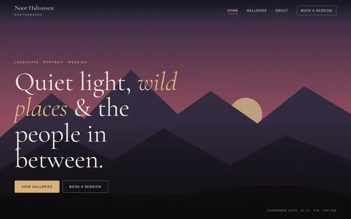](https://zumatools.com/website-templates/photography/)

Immersive dark portfolio for photographers: full-bleed masonry galleries with keyboard and swipe lightbox, galleries index, about page and booking form.

**Pages:** index.html, galleries.html, gallery.html, about.html, booking.html · **Features:** Responsive, Full-bleed masonry gallery, Lightbox (keyboard + swipe), Galleries index, Single gallery page, Booking form with packages (demo)

[Live preview & customise](https://zumatools.com/website-templates/photography/) · [Download ZIP](https://zumatools.com/templates-zip/photography.zip) · [Source](templates/photography/)

### Mara — Designer & illustrator portfolio

[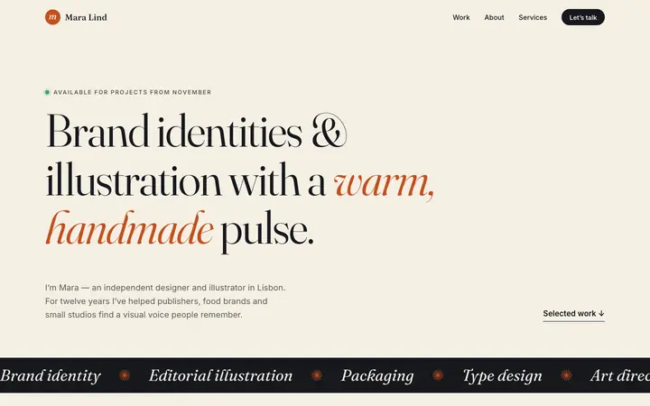](https://zumatools.com/website-templates/designer-portfolio/)

Editorial portfolio template for designers and illustrators: staggered work grid with hover reveals, about, services, clients, contact form and a case study page.

**Pages:** index.html, project.html · **Features:** Responsive, Staggered work grid, Hover reveals, Case study page, Scroll reveal animations, Mobile menu

[Live preview & customise](https://zumatools.com/website-templates/designer-portfolio/) · [Download ZIP](https://zumatools.com/templates-zip/designer-portfolio.zip) · [Source](templates/designer-portfolio/)

### Terminal — Developer résumé & portfolio

[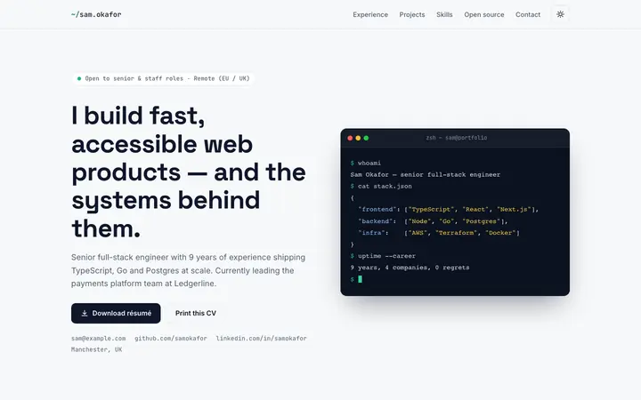](https://zumatools.com/website-templates/developer-portfolio/)

Résumé website for software developers: terminal-style hero, experience timeline, projects with tech tags, skills, open-source stats, dark mode and print-ready CV.

**Pages:** index.html · **Features:** Responsive, Light/dark toggle (saved), Print stylesheet (1–2 page CV), Terminal-style hero, Experience timeline, Project cards with tech tags

[Live preview & customise](https://zumatools.com/website-templates/developer-portfolio/) · [Download ZIP](https://zumatools.com/templates-zip/developer-portfolio.zip) · [Source](templates/developer-portfolio/)

### Iris — Personal blog

[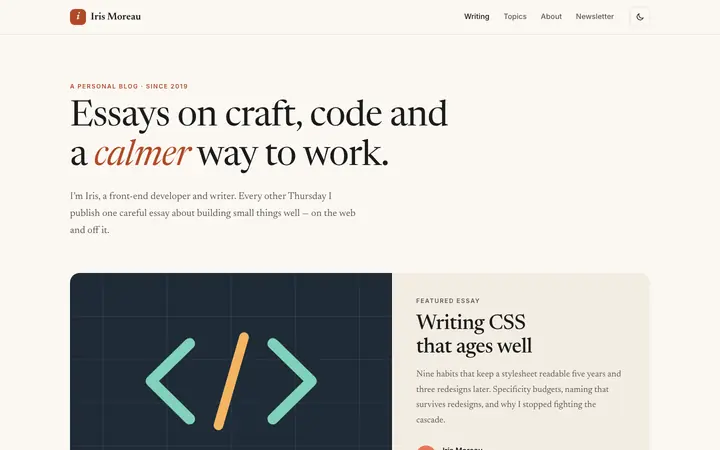](https://zumatools.com/website-templates/personal-blog/)

Clean, readable personal blog template with featured post, tag filtering, newsletter signup, article page with table of contents, code blocks, pull quotes and dark mode.

**Pages:** index.html, post.html, about.html · **Features:** Responsive, Dark mode toggle (saved), Featured post, Tag filtering, Newsletter form (demo), Table of contents with scroll-spy

[Live preview & customise](https://zumatools.com/website-templates/personal-blog/) · [Download ZIP](https://zumatools.com/templates-zip/personal-blog.zip) · [Source](templates/personal-blog/)

### Linkly — link in bio page (3 styles)

[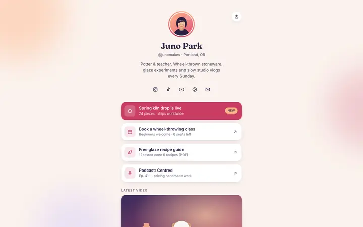](https://zumatools.com/website-templates/link-in-bio/)

A tiny, fast link-in-bio page for creators in three styles — soft, glass and bold — with links, socials, a featured video and a newsletter form.

**Pages:** index.html, variant-glass.html, variant-bold.html · **Features:** Mobile-first, 3 style variants, Featured link badge, Social icons, Featured video card, Newsletter form

[Live preview & customise](https://zumatools.com/website-templates/link-in-bio/) · [Download ZIP](https://zumatools.com/templates-zip/link-in-bio.zip) · [Source](templates/link-in-bio/)

### Evermore — Wedding website

[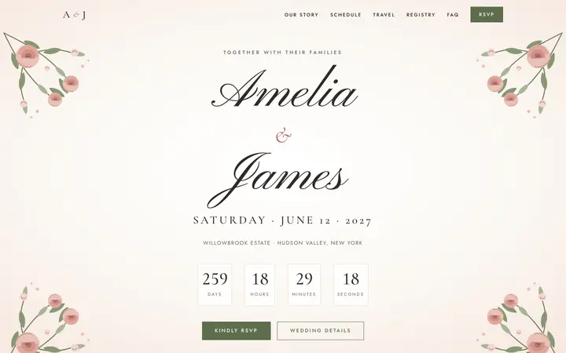](https://zumatools.com/website-templates/wedding/)

Romantic wedding website template with live countdown, love-story timeline, schedule, venue and travel, RSVP with meal choices, registry and FAQ.

**Pages:** index.html · **Features:** Responsive, Mobile menu, Live countdown, Story timeline, Event schedule, Venue & travel with hotels

[Live preview & customise](https://zumatools.com/website-templates/wedding/) · [Download ZIP](https://zumatools.com/templates-zip/wedding.zip) · [Source](templates/wedding/)

### SHIFT/26 — tech conference & event website

[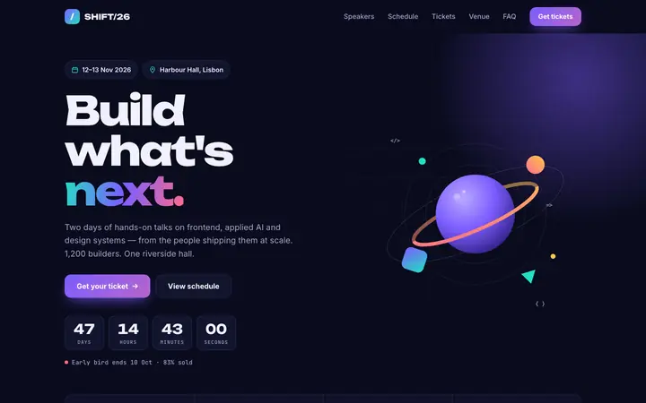](https://zumatools.com/website-templates/event-conference/)

A bold, dark website for tech conferences and meetups with a live countdown, speaker grid, multi-track schedule tabs, ticket tiers, sponsors, venue map and FAQ.

**Pages:** index.html · **Features:** Responsive, Dark design, Mobile menu, Live countdown, Speaker grid with illustrated avatars, Multi-track schedule with day tabs

[Live preview & customise](https://zumatools.com/website-templates/event-conference/) · [Download ZIP](https://zumatools.com/templates-zip/event-conference.zip) · [Source](templates/event-conference/)

### Tandem — responsive HTML email templates (5-pack)

[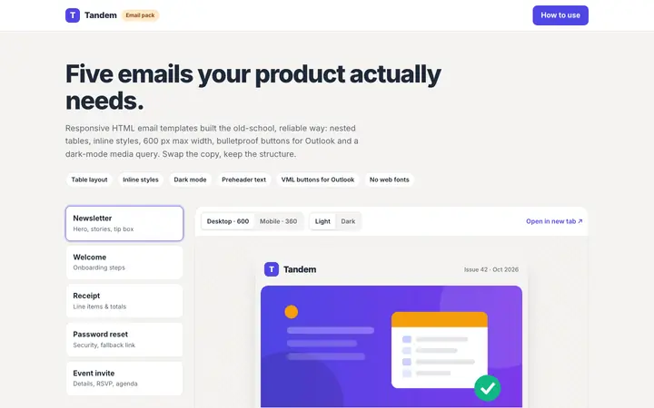](https://zumatools.com/website-templates/email-templates/)

Five responsive HTML email templates — newsletter, welcome, receipt, password reset and event invite — table-based, 600px, dark-mode ready, with Outlook buttons.

**Pages:** index.html, newsletter.html, welcome.html, receipt.html, password-reset.html, event-invite.html · **Features:** Table-based layout, Inline styles + <style> block, 600px max width, fluid on mobile, Stacking columns on small screens, Bulletproof buttons (VML for Outlook), Dark-mode media query

[Live preview & customise](https://zumatools.com/website-templates/email-templates/) · [Download ZIP](https://zumatools.com/templates-zip/email-templates.zip) · [Source](templates/email-templates/)

### Aube — coming soon page

[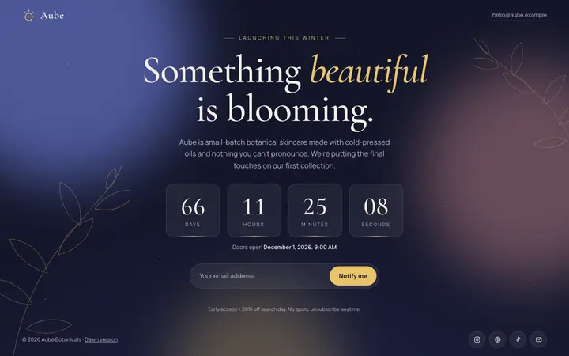](https://zumatools.com/website-templates/coming-soon/)

An elegant coming soon page with a live launch countdown, waitlist email signup, social links and a softly animated background, in dark and light variants.

**Pages:** index.html, dawn.html · **Features:** Responsive, Live countdown (date set in main.js), Email waitlist form, Two colour variants (dusk/dawn), Animated gradient background, Animated botanical line art

[Live preview & customise](https://zumatools.com/website-templates/coming-soon/) · [Download ZIP](https://zumatools.com/templates-zip/coming-soon.zip) · [Source](templates/coming-soon/)

### Detour — 404, 500 & maintenance page pack

[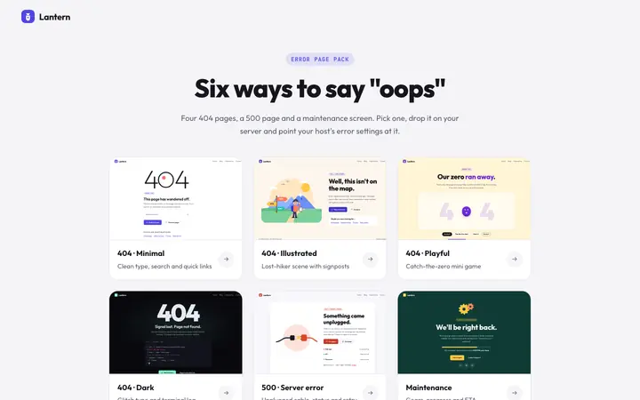](https://zumatools.com/website-templates/error-pages/)

Six ready-made error pages: minimal, illustrated, playful (with a mini game) and dark 404s, plus a 500 server error page and a maintenance screen.

**Pages:** index.html, 404-minimal.html, 404-illustrated.html, 404-playful.html, 404-dark.html, 500.html, maintenance.html · **Features:** Responsive, 6 error pages + preview gallery, Original SVG illustrations, Catch-the-zero mini game, Glitch text and terminal log, Site search form

[Live preview & customise](https://zumatools.com/website-templates/error-pages/) · [Download ZIP](https://zumatools.com/templates-zip/error-pages.zip) · [Source](templates/error-pages/)

## Licence

MIT — see [LICENSE](LICENSE). Keep the licence notice in copies of the code; attribution on the live site is appreciated but not required. Fonts are loaded from Google Fonts under the SIL Open Font License.

Made by [ZumaTools](https://zumatools.com/) — free online tools for images, PDFs, text and more, by Novpix LLC.
